# Experimental PVE **LUN-only** provisioning wizard (SolidFire Perl Plugin for PVE)

What does this plugin do, how it relates to Firemox TUI and what's the use case here?

- It does **only one step**: each run creates a "raw" LUN. That's all! No LVM, no datastore.
- Firemox TUI can do that and the rest of the steps. If you prefer using Firemox TUI, you wouldn't leave the TUI to use this Perl plugin and go back
- Who is expected to use this are people who want to run the entire workflow from the Web UI:
  - Enable iSCSI for your PVE cluster and configure VAG or get the storage tenant/account ID for PVE. Create canned QoS policies to have QoS policy IDs
  - Now you can se this plugin to create a LUN on SolidFire and present it to the cluster members
  - After that, you stay in the PVE Web UI. Create LVM on that LUN and use it as you normally would
  - Note that the plugin has limitations documented below, so familiarize yourself with all workflows before you discover them halfway in production

The [SolidFire storage plugin prototype](./solidfire-proxmox/SolidFirePlugin.pm) can create a SolidFire LUN when adding a storage in the PVE 9.3 generated custom-plugin dialog. This is still experimental and has limitations, so not a replacement for Firemox.

It declares storage API 17 on PVE 9.3 and caps the declared version to the API provided by older PVE releases; the provisioning workflow has been tested on PVE 9.3 only.

**First**, install the plugin on the PVE node(s) and reload the PVE services. This is done once.

> **NOTE:** use Firemox (PowerShell) or another tool to prepare several canned QoS policies and use those QoS policy IDs to tag new volumes in this plugin.

**Second**, every time you want to create a LUN, go to Datacenter > Storage > Add > solidfire, enter the SolidFire API URL, administrator username and password, tenant account ID, and **Provision LUN Size (GiB)**. Set **Content** to **None**. The storage ID becomes the SolidFire volume name. QoS policy is optional (defaults to SolidFire defaults).


If you prefer the CLI:

```sh
pvesm add solidfire <STORAGE_ID> \
  --apiurl '<SolidFire-API-URL>' \
  --username '<SolidFire-username>' \
  --password '<SolidFire-password>' \
  --accountid <TENANT_ACCOUNT_ID> \
  --sf-lun-size-gib <SIZE_GIB> \
  --content none
```

The plugin only creates a LUN (volume) on SolidFire. `<STORAGE-ID>` below is also going to be the volume name on SolidFire, so avoid duplicates not just here, but also on SolidFire. `content` must be `none` because this is a "raw" LUN.

Discover and log in to its iSCSI target separately, then configure a PVE iSCSI storage and shared LVM if needed. 

```sh
iscsiadm -m discoverydb -t st -p 192.168.105.30 --discover
# 192.168.105.30:3260,1 iqn.2010-01.com.solidfire:hel0.dc1.6
iscsiadm --mode node --targetname iqn.2010-01.com.solidfire:hel0.dc1.6 --login
```

The SolidFire admin password is stored under `/etc/pve/priv/storage` with mode 0600, not in `storage.cfg`. The prototype defaults to disabled TLS certificate verification; enable **Check SSL** with a trusted SolidFire certificate outside a disposable lab. Removing the PVE storage entry removes its credential file but **does not delete the SolidFire volume**. If provisioning fails or times out, check the array for an existing volume before retrying.

Run the focused tests on a PVE node with `FIREMOX_PLUGIN_PATH=/path/to/SolidFirePlugin.pm perl test-provision.t`.

## Limitations of SolidFire storage plugin

Due to plugin's experimental status, there are known limitations which are likely to remain unless there's feedback by someone who needs this to work better.

- LUN growth, snapshots, automatic target login, and LVM creation are **not implemented** for this provisioning workflow. The LUN is not a until all steps that Firemox does, have been completed.
- Post-creation edits such as QoS policy settings are not propagated to the array. Consequently, you can edit QoS settings the LUN on SolidFire and not worry about its setting in the plugin. 
- LUN deleted from PVE remains on SolidFire as that hasn't been implemented either.

You may use Firemox or perform such actions manually.

## Screenshots

Deploy plugin and use Datacenter > Storage to enter "Add storage" wizard.

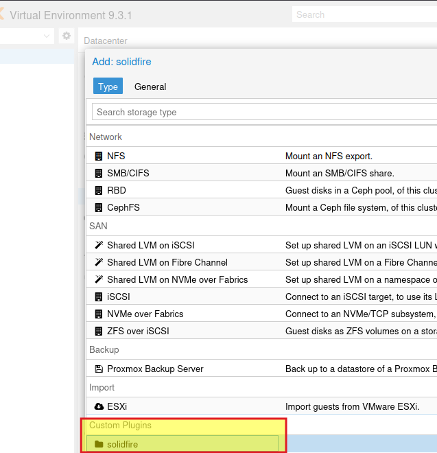

Add SolidFire volume. Because this requires a lot of copy-pasting and typing for every volume you create, consider using the CLI. If you use CHAP in iscsid.conf, use tenant ID rather than VAG. Have QoS policy IDs handy.

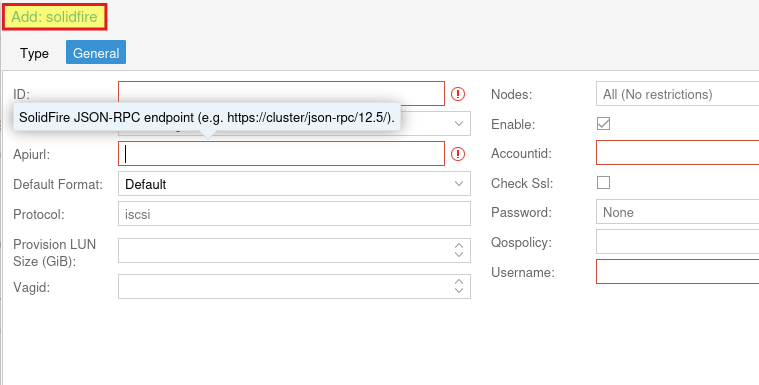

View your SolidFire volume.

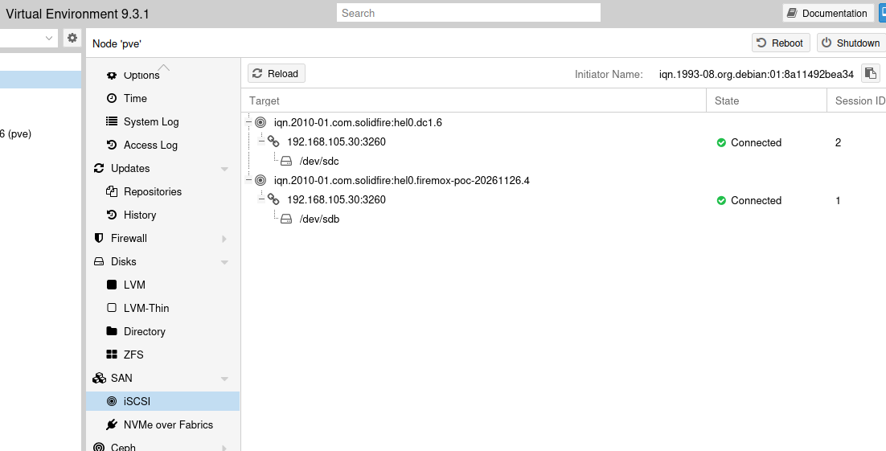

Create LVM on the volume.

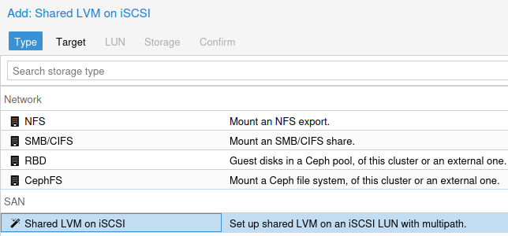

Pick a name.

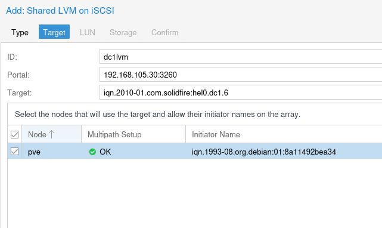

Select target LUN.

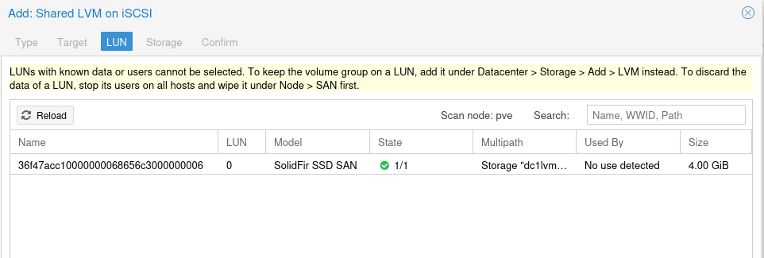

Enable LVM snapshots, they're fully supported for Shared LVM by PVE in 9.3.

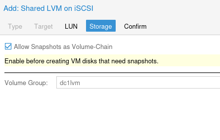

Complete the wizard.

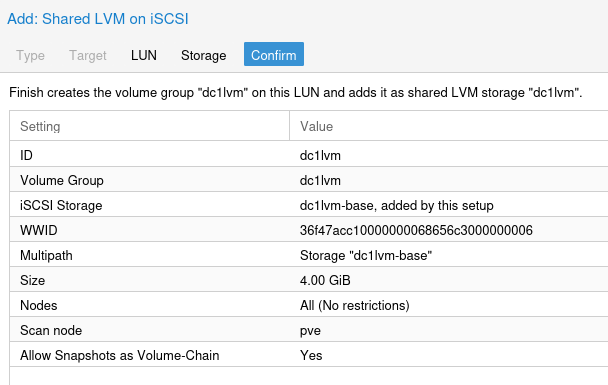

Done!

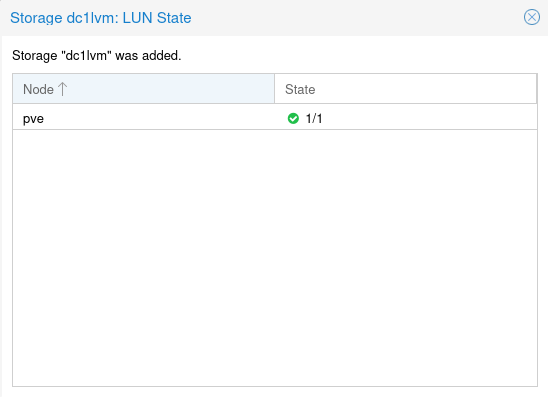

LVM on SolidFire LUN:

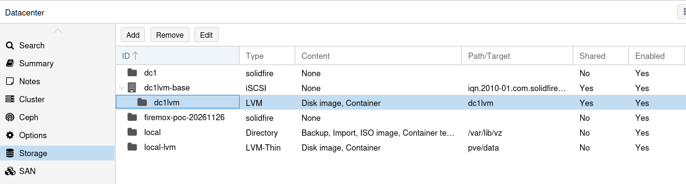

Create a CT or VM on the volume:

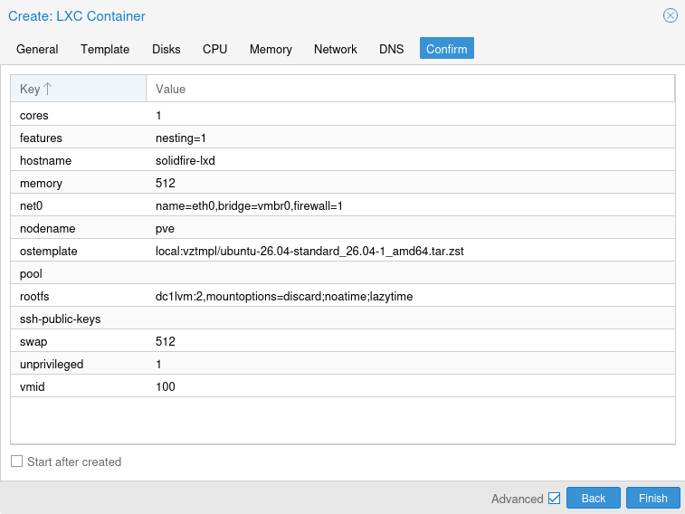

Remember to enable `discard` to have efficiencies propagate to SolidFire.

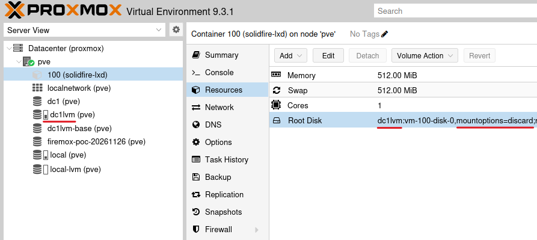

Start CT or VM.

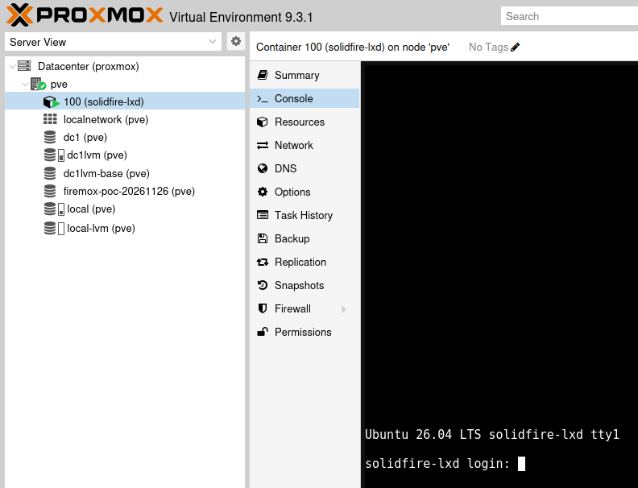
